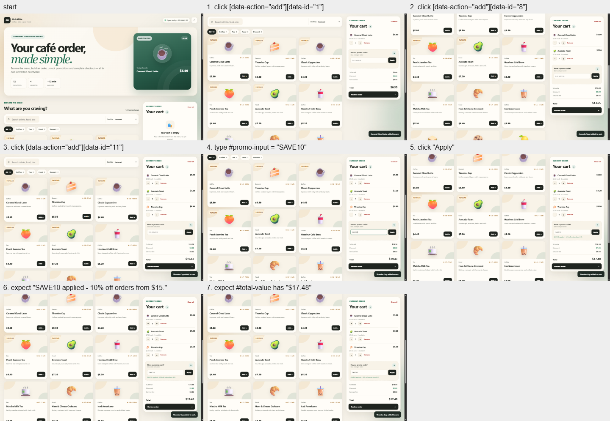
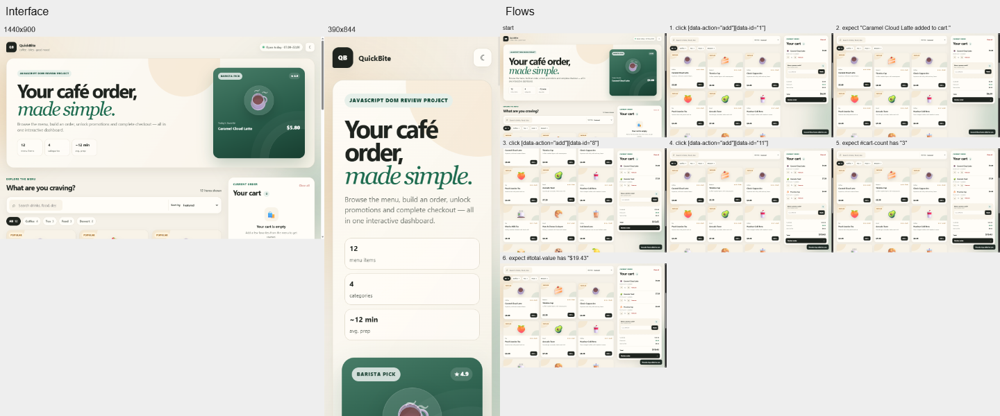
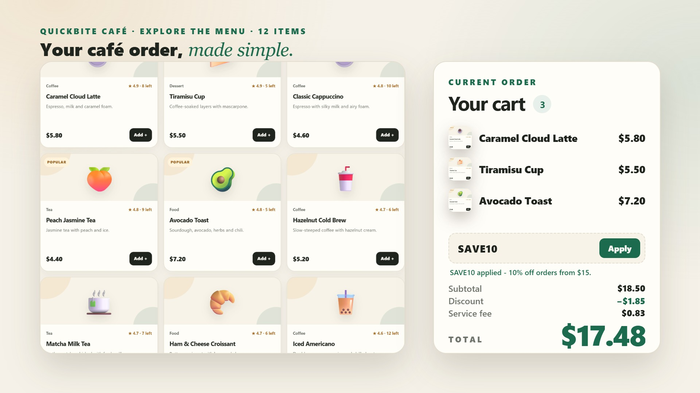
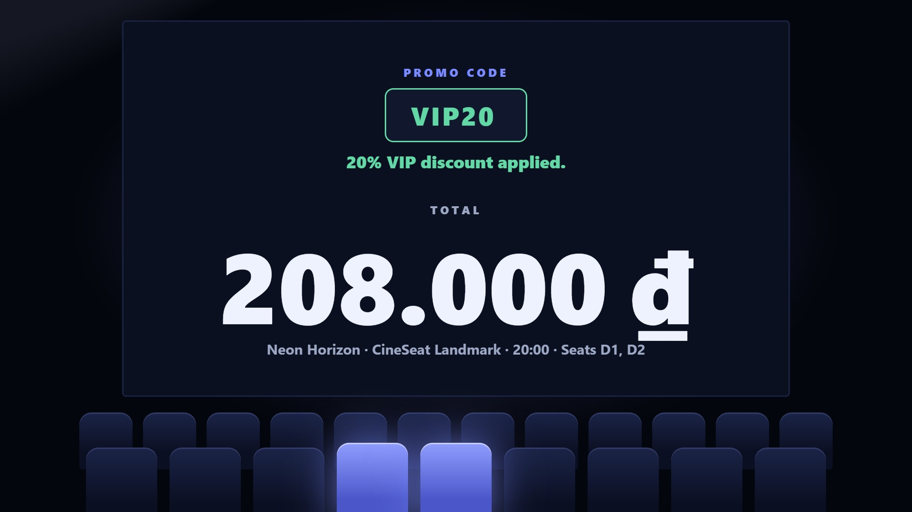

<h1 align="center">Nomi</h1>

<p align="center"><b>Your agent says done. Nomi makes it prove it.</b><br>An agent skill for interface work: plan, build, measure in a real browser, review, present.</p>

<p align="center">
  
  
  
  
</p>

<p align="center"><a href="#quick-start">Quick start</a> · <a href="#what-it-does">What it does</a> · <a href="#see-it-work">See it work</a> · <a href="#made-with-nomi">Made with Nomi</a> · <a href="docs/GUIDE.md">Guide</a> · <a href="docs/ARCHITECTURE.md">How it works</a></p>

<p align="center"><a href="media/demo.mp4"></a></p>

<p align="center"><sub>Click for the 22-second video, with sound. The page, the card under the glass and every number in it come from one real run.</sub></p>

## Why

A coding agent will tell you a page is finished without ever opening it in a browser. It reads its own code, finds it plausible, and reports success. Nomi changes what "done" means: the agent writes down what the product is for, builds, runs those jobs in a real browser, and reports only what it measured.

## What it does

Four parts, each usable on its own ("nomi-plan", "nomi-review", "write the README", "make a demo video").

### Plan

The product's jobs, written before any interface file exists, as steps a script can run.

- Names the kind of product; `nomi plan check` lints the plan and prints what that kind cannot ship without
- Each job ends in what the screen must show when it is done

### Measure

A real browser, driven by the plan.

- Captures the page at desktop and phone width and measures contrast, overflow, focus indicators and tap targets
- Runs every job: clicks, types, checks the end state; reports the step where a job stops, and clicks that change nothing
- Records motion: every animation with its duration and easing, and what is left when reduced motion is asked for
- Compares two runs of the same page, before and after

### Review

A verdict that comes from the measurements, not from the code.

- SHIP, FIX or RETHINK, with every blocking finding and the run it came from
- No SHIP over a failed job, or over evidence older than the last edit
- A proof card (`.nomi/proof.png`) that fits in a pull request

### Present

What a stranger sees first.

- A README whose commands were run, whose links and pictures exist, and whose claims are questioned
- A 20-second trailer built from the real pages of the product: 1080p, 60 frames a second, with music made for it
- No `ffmpeg`, no npm packages: the browser renders, encodes and checks it

Nothing to install beyond Node 22 and a Chromium-family browser.

## See it work

A café order page that looked finished. Nomi ran its four jobs, then reviewed it:

```text
1440x900 flows: 4 of 4 completed
  ok   Build an order of three items: 6 steps, 2.0 s
  ok   A promo code lowers the total: 7 steps, 2.2 s
  ok   Place the order: 6 steps, 2.0 s
  ok   A code is refused on an empty cart: 3 steps, 1.1 s

Review
Flows: 4 of 4 completed
Blocking:
  1. web.contrast ... contrast 4.33:1 < 4.5:1
  ...
Measured verdict: FIX (21 blocking). Do not report SHIP: fix, capture again, run review again.
```

Every job worked, and the page still was not done: 16 labels too faint to read comfortably, 3 fields with no focus indicator, 2 parts outside a phone's view. That is the difference between "it runs" and a verdict.

| The page after every step of a job | The proof card |
|---|---|
|  |  |

## Made with Nomi

Two small products, each with a trailer Nomi rendered from their real pages. Click a picture for the video.

| QuickBite Café, an order dashboard | CineSeat, a cinema booking planner |
|---|---|
| [](media/examples/quickbite.mp4) | [](media/examples/cineseat.mp4) |

## Quick start

```bash
git clone https://github.com/Miniks040506/nomi.git
cd nomi
node tools/install.mjs --hosts claude --dir ../your-project
node skills/nomi/scripts/nomi.mjs doctor
```

Then ask your agent for interface work the way you always do: "add a pricing section", "redesign the dashboard", "write the README", "make a demo video of this app".

## Hosts

Works in Claude Code, Codex, Cursor, Antigravity and Hermes. Install options and what was verified on each: [docs/HOSTS.md](docs/HOSTS.md).

## Learn more

- [The guide](docs/GUIDE.md): one real run from plan to video, every command, what was verified and what was not
- [How it works](docs/ARCHITECTURE.md): the pipeline, the measurements, the decisions and what each one cost
- [Built on](docs/GUIDE.md#built-on): the work Nomi learned from

## One more thing

Nomi's own rule applies to this page: every command above was run before it was written down, and every number was measured in a real run. If you catch this README claiming something it cannot show, that is a bug.

## Licence

None chosen yet; see [LICENSE](LICENSE).
