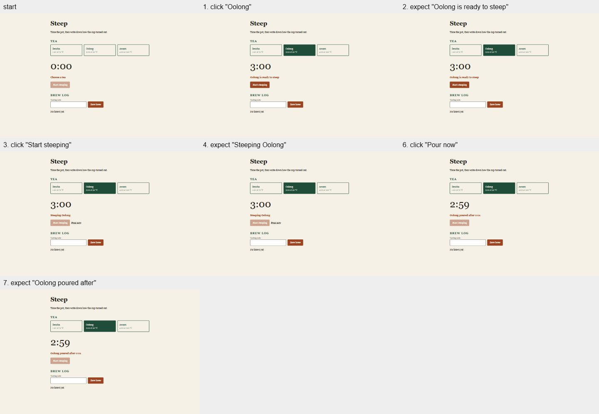
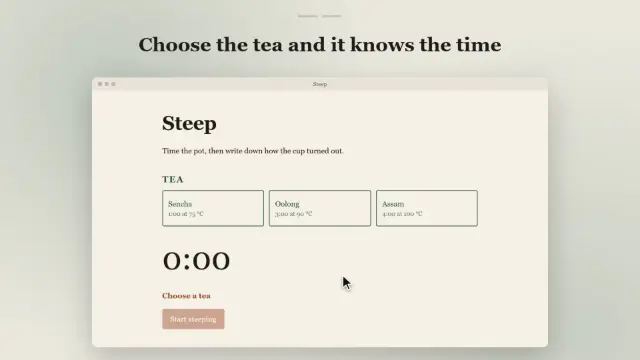

# Nomi: the guide

What Nomi leaves in a project, shown on one real run; every host; every command; what was measured and what was not.
The short version is the [README](../README.md); how it works inside is in [ARCHITECTURE.md](ARCHITECTURE.md).

## What you get

What follows is the output of one run, the one in the video: [media/tour/run.txt](../media/tour/run.txt).

### 1. The jobs, written as steps

For a new product or a redesign the agent first states what kind of product this is, who uses it and what they must get done, and writes those jobs as flows. A flow is plain data:

```json
{"name": "Steep an oolong and pour it", "steps": [
  {"do": "click", "name": "Oolong"},
  {"do": "click", "name": "Start steeping"},
  {"do": "click", "name": "Pour now"},
  {"do": "expect", "text": "Oolong poured after"}
]}
```

### 2. The jobs, run for real

`nomi observe index.html --flow .nomi/flows.json` plays each one in the browser and keeps a sheet of screenshots per job:

```text
1440x900 flows: 3 of 3 completed
  ok   Steep an oolong and pour it: 7 steps, 3.3 s
  ok   Save the brew with a tasting note: 7 steps, 2.3 s
  ok   Nothing to save before a tea is poured: 4 steps, 1.2 s
```



### 3. A verdict from what was measured

`nomi review index.html` captures the page again at desktop and phone widths, runs the flows, lists what blocks shipping and what nothing verified, and writes a proof card:

```text
Flows: 3 of 3 completed
Not verified:
  - motion, hover and press states: no --motion run
  - contrast over images or gradients (reported as unknown)
  - anything outside the flows that ran, and effects a flow cannot see (canvas, sound, clipboard)
Measured verdict: nothing measured blocks SHIP. SHIP, FIX or RETHINK is now your judgment of the opened images.
```

### 4. A demo filmed from the jobs that passed

The agent writes a storyboard (a hook, which flows to show, one caption each) and `nomi brandvid index.html` films those flows in the running product. A flow that fails while it is filmed is left out.

```text
Video   .nomi/video/demo.mp4  22.3 s, 1920x1080, 4.1 MB (H.264 MP4, sound AAC)
Preview .nomi/video/preview.webp  11 s loop, 0.5 MB (animated image)
Scenes:
  ok   Steep an oolong and pour it: 2.5–10.7 s
  ok   Save the brew with a tasting note: 10.7–19.3 s
Check: passed.
```



### 5. A README that is checked

Asked for a README, the agent runs every command the page will tell a reader to type (`nomi readme run "<command>"`) and `nomi readme check` then refuses pictures that do not exist, links and anchors that lead nowhere, and commands nobody ran. On this file it prints:

```text
README.md: nothing to fix
```

### And a memory

`.nomi/dna.md` holds the project's intent, character, a Never list and dated decisions. Every session and every agent extends the same file, so a tweak stays a tweak and the next page looks like it belongs to the last one.

## Hosts

| Host | How |
|---|---|
| Claude Code | `claude --plugin-dir <path-to-this-repo>`, or `node tools/install.mjs --hosts claude --dir <project>` (writes `.claude/skills/nomi`) |
| OpenAI Codex | `node tools/install.mjs --hosts codex --dir <project>` (writes `.agents/skills/nomi`) |
| Cursor | `node tools/install.mjs --hosts cursor --dir <project>` (writes `.agents/skills/nomi`) |
| Google Antigravity | `node tools/install.mjs --hosts antigravity --dir <project>` (writes `.agents/skills/nomi`) |
| Hermes Agent | `node tools/install.mjs --hosts hermes --dir <project>` (writes `.agents/skills/nomi`), then `hermes skills trust` in the project, which must be a git repository |
| OpenCode, Gemini CLI, OpenClaw, Kiro | `node tools/install.mjs --hosts <id> --dir <project>`; not verified end to end, see [hosts](HOSTS.md) |

Installer options: `--scope project|user`, `--hosts all|claude,codex,cursor,opencode,gemini,antigravity,openclaw,hermes,kiro`, `--dir <project>`, `--dry-run`, `--uninstall`. Running it again replaces the Nomi folder with the current version; it never touches a folder that is not Nomi. Choose only the hosts you use: `all` writes three folders (`.agents/skills`, `.claude/skills`, `.kiro/skills`), and some hosts read two of them and would list Nomi twice.

A project install adds one line to the project's `CLAUDE.md` (Claude Code) or `AGENTS.md` (other hosts) telling the agent to load Nomi for interface work, a README or a demo video. Without that line agents skip the skill on roughly four page edits in ten. `--uninstall` removes the line. The Claude Code plugin adds the same line at session start through a hook. A `--scope user` folder install has neither: add the line to your project yourself, or expect the skill to be skipped sometimes. `nomi dna init` adds one more line pointing to `.nomi/dna.md`. To remove Nomi from a project, uninstall, delete that line and the `.nomi/` folder.

## The CLI

Run it from the project you want to inspect. `nomi` below is `node <skills-folder>/nomi/scripts/nomi.mjs`.

```text
nomi observe <url-or-html-file>                       capture and measure at desktop and phone widths
nomi observe <url-or-html-file> --motion              animations, replayed frames, reduced motion
nomi observe <url-or-html-file> --flow <flows.json>   run the product's jobs as steps
nomi review <url-or-html-file>                        capture, run the flows, measured verdict, proof card
nomi brandvid <url-or-html-file>                      film the flows of .nomi/storyboard.json into .nomi/video/
nomi readme run "<command>"                           run a quick-start command and record the result
nomi readme check                                     lint the README against what exists and what was run
nomi plan init --type <booking|pos|admin|...>         start .nomi/plan.md
nomi doctor                                           check the setup
```

- Runs are saved in the project's `.nomi/runs/` (the latest ten are kept). File and folder targets are served as static files; framework apps need their own dev server and a URL. Set `NOMI_BROWSER` to a browser executable if discovery fails.
- A flow acts on the page for real, and so does a recording: both run on a file, a folder or a localhost URL, refuse requests that would change data on another site, and need `--live` for any other URL.
- The video is H.264 MP4 at 1920x1080 and 60 frames a second, with sound, composed and encoded by the browser itself. The page is filmed frame by frame under its own clock, so what the product animates runs evenly on any machine. The camera holds: at most one slow move a scene. The music and effects are made for each video; no audio file is used. It comes with a poster, a short animated preview for places that do not play video, and a sheet of eight moments an agent can read. Its pace follows the kind of product: a till is quick, a dashboard calm.
- **Codex on Windows.** Its `workspace-write` sandbox stops Chromium from starting its own sandbox. Set `NOMI_BROWSER_NO_SANDBOX=1`, which Nomi accepts only for local pages and records in the run report.

## Verified

Measured on Windows 11 on 2026-10-08:

- The demo at the top: 3 of 3 flows completed while they were filmed, and the video passed its own check (length, no black stretch and no stretch over 2 seconds in which nothing happens, every frame of the file matching what was composed, every storyboard flow shown, captions readable, a sound track that plays).
- No change in that video happens in a single frame, and it moves the way five reference launch videos do (58% of its frames are still, a movement lasts 0.6 s): measured frame by frame.
- Asked only "Make a demo video of this app.", Claude Code and Codex each produced a video that passed the check.
- `node tools/install.mjs` and `nomi doctor` as written in the quick start.
- Five hosts load the skill and run its scripts end to end. Versions and dates are in [hosts](HOSTS.md).

## Not verified

- How the video sounds: it is measured for level and length, not listened to by the script.
- macOS, and Linux installs of the hosts themselves.
- OpenCode, Gemini CLI, OpenClaw and Kiro: installed by their documentation only.
- Whether a hosting page other than a GitHub repository shows the linked preview the same way.
- Motion drawn frame by frame from script (canvas, `requestAnimationFrame`) is not measured, and an effect only on a canvas, in sound or on the clipboard is not seen by a flow.

## Built on

Nomi takes mechanisms, not text or code, from work that came before it:

- [brag](https://github.com/latent-spaces/brag) by Shunit Haviv Hakimi (MIT): how a launch video is built and how it must move (the hook first, the real product, text held for its reading time, nothing that changes in one frame).
- [OpenMontage](https://github.com/calesthio/OpenMontage) (AGPL-3.0) and the Hyperframes animation rules it carries: how a camera behaves in a product demo (one or two moves a scene, eased, a hold after each). [timesnap](https://github.com/tungs/timesnap) and [timeweb](https://github.com/tungs/timeweb) by Steve Tung (BSD-3-Clause): filming a page frame by frame under a clock taken over inside it.
- Anthropic's `frontend-design` and `code-review` skills (Apache-2.0), [superpowers](https://github.com/obra/superpowers) by Jesse Vincent (MIT), [taste-skill](https://github.com/Leonxlnx/taste-skill) (MIT) and `ui-ux-pro-max` (MIT): reading the product before designing, verifying a finding before reporting it, no "done" without the output that proves it.
- The READMEs of [uv](https://github.com/astral-sh/uv) and [Bubble Tea](https://github.com/charmbracelet/bubbletea), and the [awesome-readme](https://github.com/matiassingers/awesome-readme) list (CC0): the order of this page.
